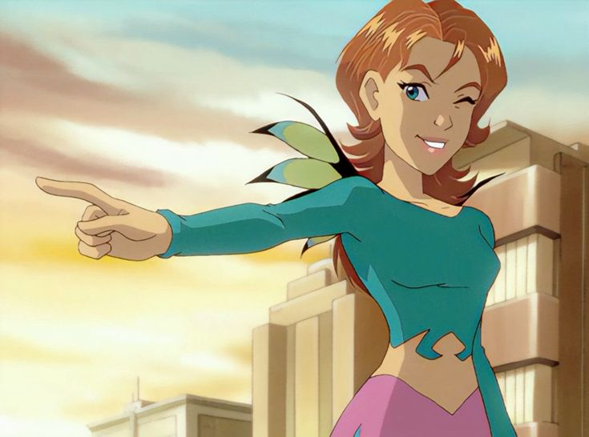

# Привет! Я — Ирма Лэр

## 👩‍🎤 Кто я?
Я — **Ирма Лэр**, одна из пяти Чародеек (Стражниц) в комиксах и мультсериале **W.I.T.C.H.** («Чародейки»).

Мне 13 лет, я весёлая и оптимистичная школьница с отличным чувством юмора. Обожаю быть в центре внимания, слушать рок-музыку (моя кумир — певица **Кармилла**), подолгу принимать ванны и, конечно, вкусно поесть! 🍕

У меня каштановые волнистые волосы и зеленовато-голубые глаза. В образе Стражницы мой костюм выполнен в бирюзово-фиолетовой гамме. А ещё у меня есть верный питомец — черепашка по имени **Листик** 🐢.

## 🌊 Моя сила
Я — **хранительница стихии воды**. Я умею:
*   Управлять водой в любых формах (жидкость, пар, лёд).
*   Создавать водные потоки и пузыри с воздухом (чтобы дышать под водой).
*   Менять форму воды, замораживать и испарять её, в том числе вытягивать влагу.
*   *Бонус:* позже у меня раскрывается способность влиять на разум и видеть прошлое и будущее в осознанных снах. 🌙

Также, как и другие Стражницы, я могу летать, телепортироваться и трансформироваться.

### Мои увлечения:
1.  **Болтать по телефону** с подругами (особенно с Хай Лин).
2.  **Собирать сплетни** — я знаю всё о всех в школе!
3.  **Слушать рок** и мечтать о сцене.

> «Чародейка Воды — это не только волны и цунами, это ещё и отличное чувство юмора!» — *Ирма*

---
*Сайт создан в рамках учебного задания по Git и GitHub Pages.*